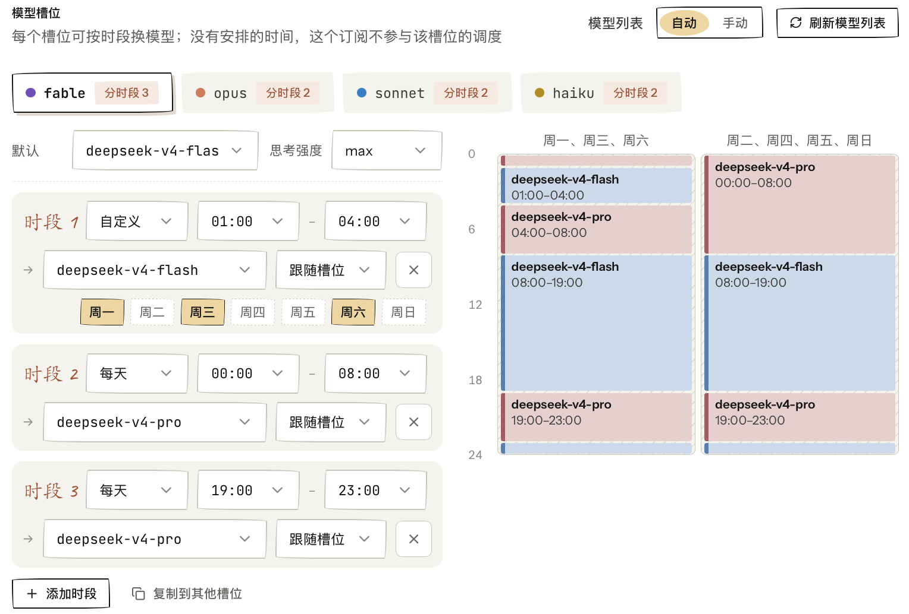
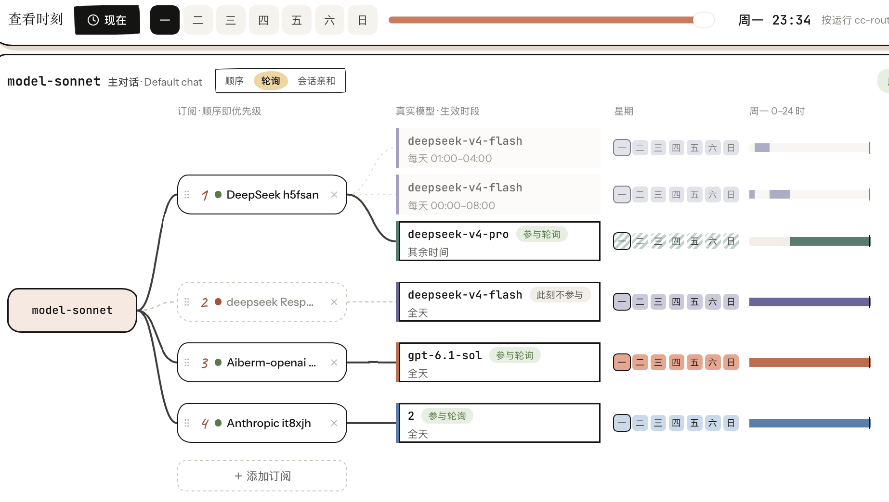

<p align="center">
  
</p>

<h1 align="center">cc-router</h1>

<p align="center">
  <a href="LICENSE"></a>
  
  
  
  
  
  
</p>

<p align="center">
  <a href="README.md">简体中文</a> · <strong>繁體中文</strong> · <a href="README.en.md">English</a> · <a href="README.ja.md">日本語</a>
</p>

<p align="center">
  <a href="https://ccrouter.app/docs/" target="_blank" rel="noopener">📖 中文文件</a> ·
  <a href="https://ccrouter.app/en/docs/" target="_blank" rel="noopener">📖 English Docs</a> ·
  <a href="https://ccrouter.app/ja/docs/" target="_blank" rel="noopener">📖 日本語ドキュメント</a> ·
  <a href="https://deepwiki.com/finch-xu/cc-router" target="_blank" rel="noopener">🤖 DeepWiki</a> ·
  <a href="https://ccrouter.app" target="_blank" rel="noopener">🌐 官方網站ccrouter.app</a>
</p>

本地執行的大模型聚合閘道，GUI桌面端app，零程式碼部署，把零散的 `Token Plan`、`Coding Plan`、大模型 API 額度聚合成一個虛擬 Plan，一鍵接入 Claude Code、Claude Desktop App、OpenClaw、OpenCode、Codex 等工具 —— 省錢！省 Token！完全本地執行！

> 注意⚠️ 本工具僅限於自動切換訂閱方案，請求體幾乎完全透傳，不涉及逆向、不涉及破解等操作。使用者需自行遵守每個程式設計方案的使用規則。此工具只能用於 Claude Code 等程式設計工具，切勿用於其他用途。
>
> 各家 provider 的 ToS 不一定明確允許"訂閱 Key 接第三方代理 + 多虛擬模型混調度"的用法，尤其是 Coding Plan / Token Plan 這類 per-seat 訂閱，可能觸發風控。因使用本工具導致帳號被限速、被封禁、訂閱被取消的，作者不承擔任何責任。
>
> 本軟體按 As-Is 提供，不對任何因使用造成的直接或間接損失負責，包括但不限於額度異常消耗、資料丟失、業務中斷。
>
> cc-router 是獨立的第三方開源專案，與 Anthropic 無任何關聯，未獲其授權或背書，也不是 Claude / Claude Code 的官方應用。文中提及的 Anthropic、Claude、Claude Code 均為 Anthropic 的商標，僅用於說明相容物件。

架構與請求走向一覽：

```text
 Claude Code  OpenCode   pi ...      Codex ...           Open WebUI ...      你的程式碼 / Agent 框架
      |           |         |            |                      |                      |
      -----------------------            |                      |                      |
                 |                       |                      |                      |
             Anthropic                OpenAI                 OpenAI                   Jev
           Messages API            Responses API      Chat Completions API        System One
          (/v1/messages)          (/v1/responses)    (/v1/chat/completions)     (/v1/systemone)
                 |                       |                      |                      |
                 -----------------------------------------------------------------------
                                                    |  入口 · 虛擬模型
                                                    |
                                                cc-router
                                         (本地 127.0.0.1:23456)
                                                    |
                                                    |  出口 · 真實模型
              ------------------------------------------------------------------------------
              |          |          |          |          |          |          |          |
          DeepSeek      GLM       Kimi     Anthropic   OpenAI     Gemini       Jev      ......
             API      Coding     Coding    Messages  Responses &    API    System One
                       Plan       Plan        API    Completions
```

功能亮點：

- **入口三協議，工具隨便接** —— 同時開放 Anthropic Messages / OpenAI Responses / OpenAI Chat Completions 三個端點，Claude Code、Codex、OpenClaw、Hermes Agent、Kimi Code、ZCode、Cherry Studio 等無需改造直接接入；另有 `/v1/systemone` 入口專供 Jev（System One）決策模型，走獨立的虛擬模型 `model-jev`
- **出口三協議，訂閱一站調度** —— 內建 24 家廠商預設（DeepSeek、Qwen、Kimi、MiMo、MiniMax、GLM、Claude、OpenAI、Gemini 等），任何 Anthropic / OpenAI / Gemini 相容端點也能直接配進來
- **聚合所有模型Token** —— 依序 / 輪詢 / 工作階段親和、自動切換、故障轉移
- **用量小票** —— token 用量一鍵匯出成一張「超市小票」樣式的消費憑證，曬圖、留檔都方便
- **四語完整翻譯** —— 简体中文 / 繁體中文 / English / 日本語，可跟隨系統或在設定頁手動切換
- **桌面 / 網頁 / 終端機三種介面** —— 除了桌面 GUI，還能在瀏覽器裡開啟與桌面完全相同的[網頁介面](#網頁介面可選預設關閉)，或用[終端機 TUI 介面](#終端機介面可選預設關閉)在命令列裡管理訂閱、檢視即時路由與請求紀錄
- **虛擬模型多別名** —— fable / opus / sonnet / haiku 四個槽位各識別多種命名，以 opus 為例，`model-opus` / `claude-opus-4-7` / `anthropic/model-opus` / `anthropic/claude-opus-4-7` 都路由到同一虛擬模型，工具用什麼命名都不挑
- **本地 HTTPS** —— 一鍵產生自簽 CA 與伺服器憑證，讓只支援 HTTPS 的客戶端也能接入 cc-router，詳見[設定教學](https://ccrouter.app/docs/claude-desktop-integration/)
- **接入 Claude Desktop App** —— 藉助本地 HTTPS 與虛擬模型別名，Anthropic 官方桌面端可直接走 cc-router 聚合的多家訂閱，詳見[設定教學](https://ccrouter.app/docs/claude-desktop-integration/)

<table align="center">
  <tr>
    <td align="center" width="50%"><br /><sub><b>即時路由</b> · 請求流向一圖看全</sub></td>
    <td align="center" width="50%"><br /><sub><b>虛擬模型</b> · 拖曳排訂閱優先順序</sub></td>
  </tr>
  <tr>
    <td align="center" width="50%"><br /><sub><b>請求紀錄</b> · 每次請求的模型、耗時與 token</sub></td>
    <td align="center" width="50%"><br /><sub><b>用量小票</b> · token 用量匯出成小票</sub></td>
  </tr>
  <tr>
    <td align="center" width="50%"><br /><sub><b>終端機介面總覽</b> · 訂閱健康與額度一屏看完</sub></td>
    <td align="center" width="50%"><br /><sub><b>終端機介面請求詳情</b> · 單次請求的完整記錄</sub></td>
  </tr>
</table>

## 接入指南

下方這些 AI Agent / Coding Agent 工具都能接入 cc-router，用上你手裡的全部大模型 Plan：

<p>
<a href="https://ccrouter.app/docs/getting-started/" target="_blank" rel="noopener">Claude Code cli</a> · 
<a href="https://ccrouter.app/docs/claude-desktop-integration/" target="_blank" rel="noopener">Claude Desktop App</a> · 
<a href="https://ccrouter.app/docs/codex-integration/" target="_blank" rel="noopener">OpenAI Codex cli</a> · 
<a href="https://ccrouter.app/docs/codex-integration/" target="_blank" rel="noopener">OpenAI Codex Desktop App</a> · OpenCode · OpenClaw · Kimi code cli · pi coding agent 等，還有很多。
</p>

## 安裝使用

1. 從下表下載對應平台的安裝檔並安裝。
2. 新增各家廠商的訂閱，給虛擬模型綁定真實模型並選好調度模式。
3. 把產生的設定貼到 Claude Code 等工具裡即可使用。

| 系統 | 架構 | 安裝檔 | 下載 |
|---|---|---|---|
| macOS | Apple Silicon | `cc-router_macOS-arm64.dmg` | [全球下載](https://github.com/finch-xu/cc-router/releases/latest/download/cc-router_macOS-arm64.dmg) · [中國下載](https://d.cc-router.catonthe.top/latest/cc-router_macOS-arm64.dmg) |
| macOS | Intel | `cc-router_macOS-x64.dmg` | [全球下載](https://github.com/finch-xu/cc-router/releases/latest/download/cc-router_macOS-x64.dmg) · [中國下載](https://d.cc-router.catonthe.top/latest/cc-router_macOS-x64.dmg) |
| Windows | x64 | `cc-router_windows-x64-setup.exe` | [全球下載](https://github.com/finch-xu/cc-router/releases/latest/download/cc-router_windows-x64-setup.exe) · [中國下載](https://d.cc-router.catonthe.top/latest/cc-router_windows-x64-setup.exe) |
| Windows | x64 (MSI) | `cc-router_windows-x64.msi` | [全球下載](https://github.com/finch-xu/cc-router/releases/latest/download/cc-router_windows-x64.msi) · [中國下載](https://d.cc-router.catonthe.top/latest/cc-router_windows-x64.msi) |
| Windows | arm64 | `cc-router_windows-arm64-setup.exe` | [全球下載](https://github.com/finch-xu/cc-router/releases/latest/download/cc-router_windows-arm64-setup.exe) · [中國下載](https://d.cc-router.catonthe.top/latest/cc-router_windows-arm64-setup.exe) |
| Linux | x64 | `cc-router_linux-x64.AppImage` | [全球下載](https://github.com/finch-xu/cc-router/releases/latest/download/cc-router_linux-x64.AppImage) · [中國下載](https://d.cc-router.catonthe.top/latest/cc-router_linux-x64.AppImage) |
| Linux | x64 | `cc-router_linux-x64.deb` | [全球下載](https://github.com/finch-xu/cc-router/releases/latest/download/cc-router_linux-x64.deb) · [中國下載](https://d.cc-router.catonthe.top/latest/cc-router_linux-x64.deb) |
| Linux | arm64 | `cc-router_linux-arm64.AppImage` | [全球下載](https://github.com/finch-xu/cc-router/releases/latest/download/cc-router_linux-arm64.AppImage) · [中國下載](https://d.cc-router.catonthe.top/latest/cc-router_linux-arm64.AppImage) |
| Linux | arm64 | `cc-router_linux-arm64.deb` | [全球下載](https://github.com/finch-xu/cc-router/releases/latest/download/cc-router_linux-arm64.deb) · [中國下載](https://d.cc-router.catonthe.top/latest/cc-router_linux-arm64.deb) |

> 兩個位址內容完全相同，中國大陸使用者選「中國下載」更快。連結始終指向最新版本，歷史版本見 [Releases](https://github.com/finch-xu/cc-router/releases)。Linux 推薦 AppImage，支援應用內自動更新；deb 需手動重新下載升級。

## 在 Claude Code 中使用

```json
{
  "env": {
    "ANTHROPIC_BASE_URL": "http://127.0.0.1:23456",
    "ANTHROPIC_AUTH_TOKEN": "your token, show in this app settings",
    "API_TIMEOUT_MS": "3000000",
    "ANTHROPIC_MODEL": "model-fable",
    "ANTHROPIC_DEFAULT_FABLE_MODEL": "model-fable",
    "ANTHROPIC_DEFAULT_OPUS_MODEL": "model-opus",
    "ANTHROPIC_DEFAULT_SONNET_MODEL": "model-sonnet",
    "ANTHROPIC_DEFAULT_HAIKU_MODEL": "model-haiku",
    "CLAUDE_CODE_SUBAGENT_MODEL": "model-opus",
    "CLAUDE_CODE_DISABLE_NONESSENTIAL_TRAFFIC": "1",
    "CLAUDE_CODE_DISABLE_NONSTREAMING_FALLBACK": "1",
    "CLAUDE_CODE_ATTRIBUTION_HEADER": "0",
    "CLAUDE_CODE_EFFORT_LEVEL": "max"
  }
}
```

當`OPUS_MODEL`支援`1m`上下文的時候，可以設定為`model-opus[1m]`以獲得Claude code工具的完整上下文支援。

也相容 LiteLLM 風格的 `anthropic/` 字首：`anthropic/model-opus` / `anthropic/model-sonnet` / `anthropic/model-haiku` 等同於無字首寫法，方便接入需要帶 provider 字首才能識別 Anthropic 協議的工具。

虛擬模型和別名：

| 虛擬模型 | 別名 |
|---|---|
|  `model-fable` |  `anthropic/model-fable` `anthropic/claude-fable*` `claude-fable*` `gpt-*-astra` `openai/gpt-*-astra` |
|  `model-opus` |  `anthropic/model-opus` `anthropic/claude-opus*` `claude-opus*` `gpt-*-sol` `openai/gpt-*-sol` |
|  `model-sonnet` |  `anthropic/model-sonnet` `anthropic/claude-sonnet*` `claude-sonnet*` `gpt-*-terra` `openai/gpt-*-terra` |
|  `model-haiku` |  `anthropic/model-haiku` `anthropic/claude-haiku*` `claude-haiku*` `gpt-*-luna` `openai/gpt-*-luna` |
|  `model-jev` |  `anthropic/model-jev` `openai/model-jev`（只在 `/v1/systemone` 入口可用，對話入口收到會回傳 400） |

> `claude-opus*` 的含義是模糊比對，你可以傳入任意符合規則的模型名，都會被歸一為虛擬模型`model-opus`，比如 `claude-opus-4-8` `claude-opus-4-7-20260101` `claude-opus-100` 都沒問題。`gpt-*-sol` 這類按檔位段符合：`gpt-6-sol` `gpt-6.1-sol` `gpt-5.6-sol-20261201` 都命中 sol 檔（astra/terra/luna 同理）。只認檔位名：`gpt-5.5` 這類純版本號和 `gpt-*-mini` 不對應，會落到 `model-fallback`。

## 入口與出口

cc-router 夾在你的工具和大模型廠商中間：工具從**入口**連進來，請求從**出口**發給廠商。兩頭各支援三種主流大模型介面，可以任意組合——比如 Codex 從 OpenAI Responses 入口進來，最終由 DeepSeek 的 Anthropic 端點作答。另有一條 Jev（System One）決策模型的專用通道，入口和出口都是 `/v1/systemone`，原樣透傳。

### 入口：你的工具怎麼連 cc-router

三個對話入口共用同一套訂閱、虛擬模型、額度與工作階段親和；第四個入口 `/v1/systemone` 專供 Jev 決策模型，只調度 `model-jev`。請求紀錄的「入口介面」一欄能看到每條請求從哪個入口進來。按你的工具支援的協議展開對應一節：

<details>
<summary><b>Anthropic Messages</b> <code>/v1/messages</code> —— Claude Code、Claude Desktop、OpenCode、OpenClaw、pi、Kimi code cli 等</summary>

| 設定項 | 填寫 |
|---|---|
| Base URL | `http://127.0.0.1:23456`（不帶 `/v1`，工具會自己拼 `/v1/messages`） |
| 驗證 | `x-api-key: <token>` 或 `Authorization: Bearer <token>`，對應 Claude Code 的 `ANTHROPIC_API_KEY` / `ANTHROPIC_AUTH_TOKEN` |
| 模型名 | `model-fable` / `model-opus` / `model-sonnet` / `model-haiku`，或上方別名表裡的任意寫法（含 `anthropic/` 字首） |

- 這是主入口，請求原樣透傳不做協議翻譯，thinking、`output_config.effort`、`cache_control`、圖片、工具呼叫全部按 Anthropic 原生語義工作。
- Claude Code 的完整 env 範例見上方「在 Claude Code 中使用」；Claude Desktop 需要本地 HTTPS，見[設定教學](https://ccrouter.app/docs/claude-desktop-integration/)。
- 工作階段親和優先按 `x-claude-code-session-id` 請求頭、其次 `metadata.user_id` 識別工作階段。
- 在訂閱編輯頁為某條訂閱開啟「透傳客戶端請求頭」後，`anthropic-beta` / `anthropic-version` 等白名單頭會原樣轉發給該上游，按訂閱單獨設定，預設關閉。

</details>

<details>
<summary><b>OpenAI Responses</b> <code>/v1/responses</code> —— Codex CLI、Codex Desktop App 及其他 Responses 客戶端</summary>

| 設定項 | 填寫 |
|---|---|
| Base URL | `http://127.0.0.1:23456/v1` |
| API Key | cc-router 設定頁裡的 token，Codex 從 `OPENAI_API_KEY` 或 `~/.codex/auth.json` 讀取 |
| 模型名 | `gpt-*-astra` / `gpt-*-sol` / `gpt-*-terra` / `gpt-*-luna` 檔位名（如 `gpt-6-sol`，可帶 `openai/` 字首），分別落到 fable / opus / sonnet / haiku；也接受 `model-*` 寫法 |

`~/.codex/config.toml` 片段（app 內「接入指南 → Codex」有完整步驟，之後用 `codex -p cc-router` 啟動）：

```toml
[model_providers.cc-router]
name = "cc-router"
base_url = "http://127.0.0.1:23456/v1"
wire_api = "responses"
env_key = "OPENAI_API_KEY"

[profiles.cc-router]
model_provider = "cc-router"
model = "model-sonnet"
```

- 請求在內部翻譯為 Anthropic Messages：`instructions` 與 developer 訊息併入 system，`reasoning.effort` 對應為 thinking 預算，`max_output_tokens` 對應為 `max_tokens`（預設 4096，並會自動抬高到覆蓋 thinking 預算）。
- reasoning 雙向：上游的 thinking 以帶簽名的 reasoning item 回傳，客戶端下一輪原樣回傳即可保持多輪推理上下文。
- 不支援圖片輸入，也不支援 `file_search` / `web_search` / `computer_use` 這類 OpenAI 專有工具；`parallel_tool_calls` 會被忽略。
- 工作階段親和按 `prompt_cache_key`、其次 `session_id` 請求頭識別，Codex 都會自帶。
- 詳細步驟見[設定教學](https://ccrouter.app/docs/codex-integration/)。

</details>

<details>
<summary><b>OpenAI Chat Completions</b> <code>/v1/chat/completions</code> —— Open WebUI、Cherry Studio、Cline、LobeChat 等</summary>

Open WebUI、Cherry Studio、Cline、LobeChat 等只支援 OpenAI Chat Completions 的工具，把「OpenAI 相容」端點指向 cc-router 即可：

| 設定項 | 填寫 |
|---|---|
| Base URL | `http://127.0.0.1:23456/v1`（有的工具要求不帶 `/v1`，按工具提示調整） |
| API Key | cc-router 設定頁裡的 token（關閉驗證時隨便填一個非空值） |
| 模型名 | `model-fable` / `model-opus` / `model-sonnet` / `model-haiku`，或 `gpt-6-astra` / `gpt-6-sol` / `gpt-6-terra` / `gpt-6-luna` 等檔位別名，從 `GET /v1/models` 可直接拉取 |

行為說明：

- 請求在 cc-router 內部翻譯成 Anthropic Messages 走同一套調度，訂閱、虛擬模型、額度、工作階段親和全部生效；請求紀錄裡「入口介面」顯示 `/v1/chat/completions`。
- 上游的 thinking 以 `reasoning_content` 欄位回傳（DeepSeek 慣例，主流客戶端都能摺疊顯示）；對話歷史裡客戶端回傳的 `reasoning_content` 會被丟棄，不影響後續對話。
- 圖片支援 `data:` base64 與 `http(s)` 兩種 `image_url`；工具呼叫雙向支援；串流回應末尾總會帶一幀 `usage`。
- 不支援舊版 `functions` / `function_call` 欄位，傳了直接回傳 400，請改用 `tools` / `tool_choice`。
- `n>1`、`logprobs`、`response_format` 的 JSON Schema 強制均會被忽略（不報錯）。
- 工作階段親和（sticky）優先按 `user` 欄位、其次 `x-session-id` 請求頭識別工作階段，兩者都沒有時按首條使用者訊息內容。
- 回應裡出現工具呼叫時 `finish_reason` 恆為 `tool_calls`，客戶端可放心據此判斷是否執行工具。

</details>

<details>
<summary><b>Jev System One</b> <code>/v1/systemone</code> —— 你自己的程式碼、Agent 框架，或任何能發 HTTP 請求的程式</summary>

Jev（System One）是一類結構化決策模型：請求給出一段狀態 `state` 和一組問題 `questions`，回應按問題逐個回傳結構化答案 `answers`，不產生對話文字。cc-router 把多家上游的 Key 聚合在獨立的虛擬模型 `model-jev` 下，協議原樣透傳、不做翻譯。

| 設定項 | 填寫 |
|---|---|
| 介面位址 | `http://127.0.0.1:23456/v1/systemone`（寫完整路徑） |
| 驗證 | `Authorization: Bearer <token>`，`x-api-key: <token>` 也可以 |
| 模型名 | `model-jev`（可帶 `anthropic/` / `openai/` 字首），也可以直接寫上游的真實模型名 |

命令列驗證：

```bash
curl http://127.0.0.1:23456/v1/systemone \
  -H "Content-Type: application/json" \
  -H "Authorization: Bearer <token>" \
  -d '{
  "model": "model-jev",
  "state": "Hello World",
  "questions": {
    "says_hello": {
      "type": "noul",
      "instructions": "Does the state text contain a greeting?"
    }
  }
}'
```

- 寫 `model-jev` 時，cc-router 按命中訂閱設定的 Jev 模型改寫；沒配就用該接入點的範例模型（如 `clef-flash`、`jev-latest`），回應裡的 `model` 仍回顯 `model-jev`。寫真實模型名時，訂閱配了 Jev 模型就改寫，沒配就原樣透傳。
- 只調度綁在 `model-jev` 上、接入點為 System One 的訂閱；對話類訂閱不會被用到，System One 訂閱也不會進入其他虛擬模型。三個對話入口收到 `model-jev` 會直接回傳 400。
- 只支援非串流。某一家回傳 4xx 會換下一家（各家的驗證規則不完全一樣）；全部失敗時，如果是請求本身寫錯，原樣回傳最後一家的錯誤，否則回傳 503。
- 工作階段親和只認 `x-session-id` 請求頭，不帶就按輪詢分配。
- 用量計入「資料統計」與「用量小票」。

</details>

### 出口：cc-router 怎麼連廠商

出口按協議分三類，另有一類走 OAuth 登入的訂閱帳號，以及只服務 `model-jev` 的 System One 接入點。內建廠商預設和自訂端點走的是同一條路，區別只是內建預設已經替你填好位址、驗證方式和模型列表。完整內建清單以 app 內「新增訂閱」頁為準，描述檔案在 [`src-tauri/providers/`](src-tauri/providers/)，歡迎 PR 補充。

<details>
<summary><b>Anthropic Messages 相容</b> —— 主路徑，請求原樣透傳</summary>

- 內建：Anthropic 官方、DeepSeek、智譜 GLM、Moonshot Kimi、MiniMax、小米 MiMo、阿里雲百鍊、火山方舟、騰訊雲、百度千帆、階躍星辰、魔搭 ModelScope、優雲智算、Fireworks、OpenRouter、Requesty、xAI Grok、Aiberm、Ollama 等，覆蓋各家的 Token Plan / Coding Plan / Agent Plan 訂閱與按量計費 API
- 自訂：任何 Anthropic Messages 相容端點（中轉站、自建閘道等），填 Base URL + Key 即可
- 不做協議翻譯，thinking、`output_config.effort`、`cache_control`、圖片、工具呼叫全部按 Anthropic 原生語義工作。**只要廠商提供原生 Anthropic 端點，就優先走這條路**，翻譯路徑多少會丟內容

</details>

<details>
<summary><b>OpenAI 相容</b> <code>/v1/responses</code> · <code>/v1/chat/completions</code> —— 協議翻譯</summary>

- 內建：OpenAI 官方 API（GPT-5 / o3 / 4.1 等 reasoning 模型）
- 自訂：任意 OpenAI Responses 或 Chat Completions 相容端點，如 one-api / new-api 中轉站、Groq、Together、本地 vLLM / llama.cpp
- cc-router 把 Anthropic Messages 翻譯成對應協議再發出：Anthropic thinking ↔ OpenAI reasoning 雙向對應，多輪推理上下文自動回灌；Chat Completions 回傳的 `reasoning_content`（DeepSeek R1 等）會以 thinking 塊的形式交給 Claude Code
- 翻譯層表達不了的內容（如 `cache_control`）會被丟棄，所以有原生 Anthropic 端點的廠商請配到上一類，不要配到這裡

</details>

<details>
<summary><b>Gemini 相容</b> <code>generateContent</code> · <code>/v1beta/interactions</code> —— 協議翻譯</summary>

- 內建：Google AI Studio（generateContent，按量計費 + 免費 quota）、Google Gemini Interactions API（新統一介面）
- 自訂：任意 Gemini generateContent 相容端點（messages_path 用 `{model}` 佔位符），或 Interactions 相容端點（model 在請求 body 裡，無需佔位符）
- thinking 雙向對應，工具呼叫往返時自動攜帶 thought signature

</details>

<details>
<summary><b>訂閱帳號出口（OAuth）</b> —— Codex（ChatGPT Plus/Pro）、Kiro（AWS）</summary>

- 不用 API Key，透過 OAuth 裝置碼登入，把 ChatGPT 訂閱 / Kiro 免費 Claude 額度當作出口
- **屬於灰色地帶，有封號風險，不推薦當主力**，建議只做備援或副號；由此導致的限速、封禁或訂閱取消，作者概不負責

</details>

<details>
<summary><b>Jev System One</b> <code>/v1/systemone</code> —— 只服務 <code>model-jev</code>，原樣透傳</summary>

- 內建：TypeSafe、OpenRouter（System One 接入點）、Ollama 0.35+（本地 System One 接入點）、Cloudflare Clef；在「新增訂閱」裡選對應廠商的 System One 接入點即可
- 這類訂閱只有一個可選的 Jev 模型槽，留空時按上文入口一節的規則改寫或透傳
- 訂閱建立後協議固定，不能在對話接入點和 System One 接入點之間切換，要換請新建訂閱

</details>

### 網頁介面（可選，預設關閉）

設定 → 網頁介面 → 啟用後，用瀏覽器開啟 `http://127.0.0.1:23456/ui/` 即可得到與桌面完全相同的管理介面。區域網路其他裝置存取需把代理監聽位址切到 `0.0.0.0`，設定頁會列出可用位址。登入使用代理存取權杖；「登入驗證」開關可關閉（關閉後同網段裝置無需登入即可修改設定，慎用）。

### 終端機介面（可選，預設關閉）

用 `cc-router-tui` 在終端機裡管理正在執行的 cc-router。設定 → 安全與存取 → 終端機介面 → 開啟「啟用終端機介面」後即可使用（只接受本機連線，桌面 app 需保持執行）。同一張卡片裡可以複製完整的啟動路徑；點「新增到 PATH」後，在任何終端機裡直接輸入 `cc-router-tui` 即可：macOS 在 `/usr/local/bin` 建一個符號連結（可能彈出系統授權框），Windows 把安裝目錄加入使用者 PATH（已開啟的終端機需重開），AppImage 複製一份到 `~/.local/bin`（副本不隨 app 更新，更新後再點一次），deb 隨系統安裝、本來就在 PATH 上。

- **能做什麼** —— 總覽、訂閱（啟停 / 測試連線 / 重新整理模型與餘額 / 改槽位 / 新建 / 刪除）、虛擬模型、即時路由、請求紀錄；按 `?` 檢視全部鍵位。介面語言跟隨桌面 app 的語言設定（改了之後重開終端機介面生效）
- **已知限制** —— 終端機至少 80×24；部分符號屬於「模糊寬度」字元，在東亞語言環境下可能按兩列顯示導致錯位，遇到時在終端機設定裡開啟「模糊寬度字元按窄字元（單寬）顯示」一類的選項；新建 OAuth 類訂閱與修改 API Key 仍需在桌面 app 裡完成

<table align="center">
  <tr>
    <td width="33%"></td>
    <td width="33%"></td>
    <td width="33%"></td>
  </tr>
</table>

### 分時段虛擬模型

用戶端繼續使用同一個虛擬模型，cc-router 按星期和時段自動切換各訂閱槽位對應的真實模型。在桌面 app 的訂閱編輯頁中，可以為 `fable`、`opus`、`sonnet`、`haiku` 分別設定時段規則。

- **按時間安排模型** —— 為規則選擇星期、起訖時間和真實模型，右側日曆直觀呈現一週的安排；規則也可以複製到其他槽位。
- **預設模型備援** —— 未符合時段規則時使用槽位的預設模型；如果未設定預設模型，該訂閱在未涵蓋的時間不參與這個槽位的調度。
- **預覽調度關係** —— 在虛擬模型頁選擇星期並拖曳時間軸，檢視對應時刻的模型對應和調度關係；點擊「現在」回到目前時刻。時間以執行 cc-router 的電腦為準。

**模型槽位：設定時段規則與日曆預覽**



**虛擬模型：檢視各訂閱的模型與生效時段**



## 常見問題&使用場景

<details>
<summary>cc-router 解決了什麼問題？</summary>

**沒有 cc-router 時**：AI Agent（Claude Code / OpenCode 等）一次只能接一家廠商，小額度訂閱在關鍵時刻斷流，得手動切設定——體驗糟糕。

**接上 cc-router 後**：Agent → cc-router → 廠商 A + B + C，自動負載均衡、自動故障轉移，三家訂閱當一家用。

收益：

- **省錢** —— 不必買昂貴的大額 Coding Plan，兩個小額度拼起來就夠用
- **不斷流** —— 限流 / 失敗自動切換，Agent 無感
- **混搭頂配** —— GLM-5.1、DeepSeek-V4-Pro、MiniMax-2.7、MiMo-V2.5-Pro 同時上桌，也能摻 Claude Opus、GPT-5.5 這類原生 API
- **用量統一** —— 所有訂閱 token 消費一屏看完，可一鍵匯出小票

</details>

<details>
<summary><code>model-opus</code> / <code>model-sonnet</code> / <code>model-haiku</code> 三個虛擬模型是幹啥的？</summary>

Claude Code 按任務難度分三檔：opus 做規劃、sonnet 寫程式碼、haiku 跑工具呼叫。

cc-router 把這三檔抽象成 `model-opus` / `model-sonnet` / `model-haiku` 三個虛擬槽位，每個槽位綁一組真實模型 + 調度模式：

- `model-opus` → DeepSeek-V4-Pro + GLM-5.1（輪詢）
- `model-sonnet` → MiniMax-M2.7 + MiMo-V2.5-Pro（輪詢）
- `model-haiku` → GLM-4-Flash

CC 請求來了就按對應轉發，不用再頻繁改 `~/.claude/settings.json`。

</details>

<details>
<summary>有多個 Coding Plan 怎麼搭配？</summary>

舉例：訂閱 A = GLM-5 / MiniMax-2.7 / DeepSeek-Flash，訂閱 B = DeepSeek-V4-Pro / MiniMax-2.7 / GLM-5。

- **穩妥派**：把兩邊的同檔模型一起綁進對應槽位，效果一致、容災好
- **激進派**：把兩邊各自的頂配模型都塞進 `model-opus` 輪詢，交叉使用大機率 `1 + 1 ≥ 2`

</details>

<details>
<summary>調度模式：依序、輪詢還是工作階段親和？</summary>

- **依序** —— 用完 A 再切 B。命中快取好、能榨乾小額度訂閱，**推薦給兩個小額 GLM Coding Plan 這類場景**
- **輪詢** —— 兩家均衡分擔。但跨帳號的快取是獨立的，會多吃額度，換來的是真正的負載均衡
- **工作階段親和** —— 同一個 Claude Code 工作階段固定用同一家訂閱、不同工作階段輪流分配。既像輪詢一樣均衡，又不丟 prompt cache；並行子代理也能共用快取。訂閱限流/失敗時自動換家。**多家訂閱都健康、又在意快取命中時推薦。**

</details>

## 開發

- Tauri 2
- Tailwind 4
- React 19

依賴：Node.js ≥ 20（推薦 pnpm），Rust ≥ 1.90（建議直接用 rustup 最新 stable），Xcode CLT（macOS）。

```bash
pnpm install
pnpm tauri dev      # 啟動開發模式（同時執行前端 + Rust 後端 + 代理）
```

首次啟動 app 會進入 onboarding：

1. 新增一個訂閱（選廠商 → 選接入點 → 填 API Key → 自動抓取模型列表）
2. 一鍵把訂閱綁定到四個虛擬模型
3. 複製 Claude Code 環境變數設定，貼到你的 `~/.claude/settings.json`

## 打包

```bash
pnpm tauri build
```

產出：`src-tauri/target/release/bundle/` 下對應平台的安裝檔。

## Windows 開發環境注意事項

<details>
<summary>在 Windows 上開發或打包遇到問題時展開（能省幾小時）</summary>

**1. 必須用 MSVC toolchain，不能用 GNU**

Tauri 在 Windows 上打包依賴 MSVC，CI 用的也是 `x86_64-pc-windows-msvc`。確認：

```powershell
rustup show          # active toolchain 應帶 -msvc 字尾
rustc --version      # 應 ≥ 1.90
```

**2. 需要 Visual Studio Build Tools**

MSVC toolchain 依賴 C++ 編譯器和 Windows SDK，缺了會報 `link.exe not found`。裝 [Build Tools for Visual Studio](https://visualstudio.microsoft.com/downloads/) 時勾選「使用 C++ 的桌面開發」工作負載，裝完重開終端機。

**3. `rustc --version` 和 `rustup show` 對不上？查 PATH**

若曾用 msi / scoop / Visual Studio 元件裝過獨立 Rust，它可能排在 rustup shim 之前，導致 `rustup default stable` 說什麼都不生效：

```powershell
Get-Command rustc, cargo -All | Select-Object Source
```

`Source` 應指向 `%USERPROFILE%\.cargo\bin`。否則把該目錄提到 PATH 最前（`rundll32 sysdm.cpl,EditEnvironmentVariables`），或卸掉那份獨立安裝。

**4. dev server 連接埠殘留**

Ctrl+C 常殺不乾淨 `tauri dev` 的行程樹，再次啟動會報 `Port 1420 is already in use`（`strictPort: true` 刻意不自動換連接埠，因為 `devUrl` 寫死了 1420）：

```powershell
Get-NetTCPConnection -LocalPort 1420 -State Listen |
  Select-Object -ExpandProperty OwningProcess -Unique |
  ForEach-Object { Stop-Process -Id $_ -Force }
```

</details>

## 新增 provider

如果你使用`Claude Code`，我提供了一個`SKILL`，可以執行`new-provider`並附加provider的官方文件或介面位址等資訊，能夠自動建立provider的設定。

## 授權條款

本專案以 [MIT](LICENSE) 授權條款釋出。

字型：小票主題使用的 9 款字型均為 SIL Open Font License 1.1，歸屬宣告與授權條款全文見 [THIRD-PARTY-NOTICES.md](THIRD-PARTY-NOTICES.md)。

圖示：Provider 品牌 logo 來自 [@lobehub/icons](https://github.com/lobehub/lobe-icons)（MIT）。各品牌商標歸原所有者所有。
